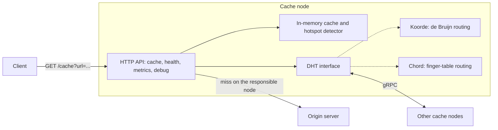
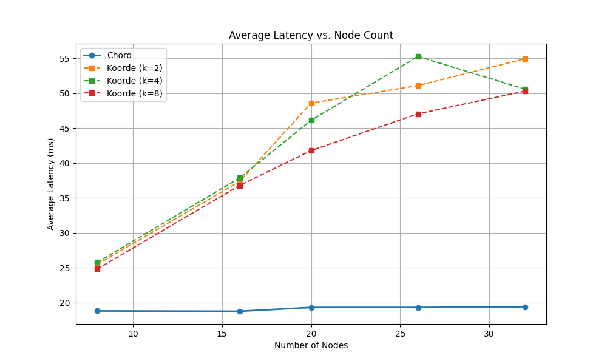
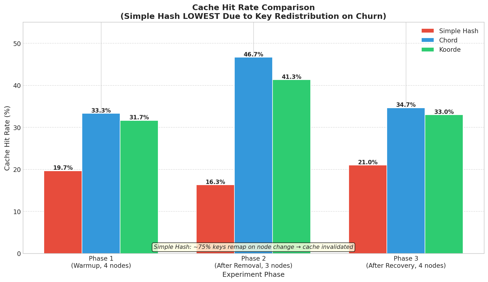
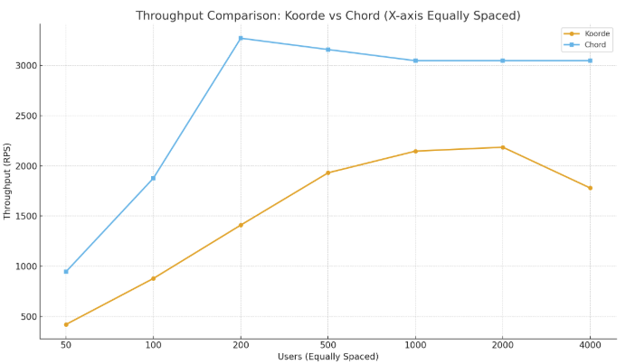

<div align="center">

# KoordeDHT Web Cache

**A distributed web cache in Go, built on two interchangeable DHTs: Koorde and Chord**

[](go.mod)
[](proto/README.md)
[](docker/instruction.md)
[](deploy/eks/README.md)

[How it works](#how-it-works) · [Results](#results) · [Quick start](#quick-start) · [Deployment](#deployment) · [Repository layout](#repository-layout) · [Credits](#credits)

</div>

Each node in this system is both a cache server and a member of a distributed hash table. A client sends a URL to any node over HTTP. The node hashes the URL, asks the DHT which node is responsible for that key, and forwards the request there. The responsible node serves the page from memory, or fetches it from the origin once and keeps it.

The DHT layer has two implementations behind one Go interface: **Koorde**, which routes over a de Bruijn graph with a configurable degree, and **Chord**, which routes with finger tables. A config setting picks one. This made it possible to run the same cache and the same workload on both protocols and compare them.

We measured lookup latency from 8 to 32 nodes on AWS EKS, cache hit rate while a node leaves and rejoins, and throughput up to 4000 simulated users. In these runs Chord was faster than Koorde every time. The report explains why this does not contradict Koorde's better asymptotic hop count: the clusters were too small to show it.

The project was built by Yuzheng Shi and one teammate, on top of an existing open-source Koorde implementation. [Credits](#credits) says what came from it and what was added.

## How it works



For a request to `/cache?url=...`, the node code in `internal/node/server/http.go` does this:

1. It hashes the URL and calls `LookUp` on the DHT interface to find the responsible node.
2. If another node is responsible, it proxies the request there. The response carries `X-Cache: MISS-DHT`.
3. If this node is responsible and has the page, it answers with `X-Cache: HIT-LOCAL`.
4. If the responsible node sees a URL as hot, it can hand the request to a random node (`MISS-HOT`). Hotspot detection is in `internal/node/cache/hotspot.go`.
5. Otherwise the responsible node fetches the page from the origin, stores it, and answers with `X-Cache: MISS-ORIGIN`.

The common interface is `DHTNode` in `internal/node/dht/interface.go`. Koorde is implemented in `internal/node/logicnode/` and `internal/node/routingtable/`, Chord in `internal/node/chord/`. `cmd/node/main.go` chooses between them from the `dht.protocol` setting (`koorde` or `chord`, see `config/node/config.yaml`). Nodes talk to each other over gRPC; the services are defined in `proto/`.

## Results

Three experiments are written up in the [benchmark report](docs/benchmark-report.md). The charts below are in `results/`. Environment and settings come from the report.

**Latency versus cluster size.** AWS EKS in us-west-2, 8 to 32 nodes, 50 concurrent users sending Zipf-distributed requests (alpha 1.2) to `/cache` and `/health`, with an nginx origin inside the cluster so that origin latency does not hide routing latency.



At 32 nodes the report gives an average of 19.4 ms for Chord, 54.9 ms for Koorde with k=2 and 50.3 ms for Koorde with k=8. At 8 nodes the averages are 18.8 ms, 25.5 ms and 24.8 ms. Tail latency differs more: at 32 nodes the P95 is 25 ms for Chord, 140 ms for Koorde with k=2 and 160 ms for Koorde with k=8.

**Cache hit rate under churn.** Four nodes, then three, then four again, with 200 unique URLs, 300 requests per phase at 50 requests per second, Zipf alpha 1.2 and Koorde degree 4. "Simple Hash" is a modulo-hash baseline. The report does not state the environment or cache size for this run.



Average hit rate over the three phases was 38.2% for Chord, 35.3% for Koorde and 19.0% for Simple Hash. Both DHTs kept far more of their cache across a membership change than the modulo baseline.

**Throughput.** Chord and Koorde under the same load, from 50 to 4000 users, measured in requests per second. The report does not state the cluster size or environment for this run. The x-axis is evenly spaced, not numeric.



Chord levels off at about 3000 requests per second. Koorde levels off at about 2200 and drops at 4000 users.

**What these results do and do not show.** The AWS Learner Lab allowed at most 9 EC2 instances per cluster, and an attempt to reach 40 nodes never became ready. The latency results hold only up to 32 nodes. They do not show whether Koorde overtakes Chord at hundreds or thousands of nodes; the report lists experiments that would test that. Raw per-request data is not in the repository.

## Quick start

You need Go 1.25 or later, as in `go.mod`. No Docker is needed for a local node.

```bash
go build -o bin/koorde-node ./cmd/node
./bin/koorde-node --config config/node/config.yaml
```

The node listens on port 4000 for gRPC and port 8080 for HTTP, and starts a new ring because its bootstrap peer list is empty. In another terminal:

```bash
curl "http://localhost:8080/health"
curl "http://localhost:8080/cache?url=https://www.example.com"
curl "http://localhost:8080/metrics"
```

The default config runs Koorde. To run Chord, set `dht.protocol: "chord"` in the node config. The [local testing guide](docs/local-testing.md) covers a multi-node cluster on one machine, the interactive DHT and cache clients, hotspot detection and the workload generator.

## Deployment

| Target | Where to look |
|--------|---------------|
| Local cluster, no containers | [docs/local-testing.md](docs/local-testing.md), configs in `config/local-cluster/` |
| Docker Compose with LocalStack standing in for Route53 | [deploy/localstack/README.md](deploy/localstack/README.md) |
| Docker Compose with Jaeger tracing | [deploy/tracing/README.md](deploy/tracing/README.md) |
| Churn and network-chaos test harness (local or EC2) | [deploy/test/README.md](deploy/test/README.md) |
| Several containers per EC2 instance, discovery through Route53 | [deploy/demonstration/README.md](deploy/demonstration/README.md) |
| AWS EKS, either protocol | [deploy/eks/README.md](deploy/eks/README.md) |
| Container images | [docker/instruction.md](docker/instruction.md) |

The EKS manifests and scripts support both `chord` and `koorde`. They were used for the latency experiment above, on an AWS Learner Lab account. This repository does not show a long-running deployment.

## Repository layout

```
cmd/
  node/            cache + DHT node (Chord or Koorde, chosen by config)
  client/          interactive DHT client (put, get, lookup, routing table)
  cache-client/    interactive cache client (cache, metrics, hotspots)
  cache-workload/  Zipf HTTP workload generator
  tester/          DHT test helper
internal/
  node/dht/        common DHT interface
  node/logicnode/  Koorde node
  node/routingtable/  Koorde de Bruijn routing table
  node/chord/      Chord node, finger table, stabilization
  node/cache/      cache and hotspot detection
  node/server/     gRPC services and the HTTP cache API
  bootstrap/       static and Route53 peer discovery
proto/             gRPC service definitions
config/            node, tester, local-cluster and chord-test configs
deploy/            eks, localstack, tracing, test, demonstration
docker/            Dockerfiles
scripts/           PowerShell scripts for local benchmarks
results/           charts and PDF reports
docs/              local testing guide, benchmark report
```

## Credits

This repository extends an existing open-source Go implementation of Koorde, [flavio-simonelli/KoordeDHT](https://github.com/flavio-simonelli/KoordeDHT), which the first commit here imported.
That repository has no license file; this one credits it and claims no rights in its code.

**From the upstream repository:** the gRPC node and its API (`proto/`, `internal/api/`), Koorde's de Bruijn routing (`internal/node/logicnode/`, `internal/node/routingtable/`), bootstrap, storage, telemetry, logging, configuration loading, and the DHT client and tester (`cmd/client/`, `cmd/tester/`, `internal/client/`).
Of the 65 Go files on `main`, 39 are unchanged from it and 12 are modified versions.

**Added in this repository** (Yuzheng Shi with one teammate):

- the web-cache layer: `internal/node/cache/` (cache and hotspot detection), the HTTP cache and metrics endpoints in `internal/node/server/http.go`, the interactive cache client (`cmd/cache-client/`) and the Zipf workload generator (`cmd/cache-workload/`);
- a Chord implementation, `internal/node/chord/` (finger table, stabilization, tests), and the common DHT interface `internal/node/dht/` that lets either protocol run behind the cache;
- the changes to the node, server, config, bootstrap and domain packages that connect them, and the lookup metrics;
- the AWS EKS deployment (`deploy/eks/`), the local multi-node configurations (`config/local-cluster/`), the LocalStack setup, the Locust load tests (on the `localstack-results` branch), and the benchmark experiments and report ([docs/benchmark-report.md](docs/benchmark-report.md)).

## References

1. Kaashoek MF, Karger DR. *Koorde: A simple degree-optimal distributed hash table.* (2003)
2. Stoica I, et al. *Chord: A scalable peer-to-peer lookup service for internet applications.* (SIGCOMM 2001)
