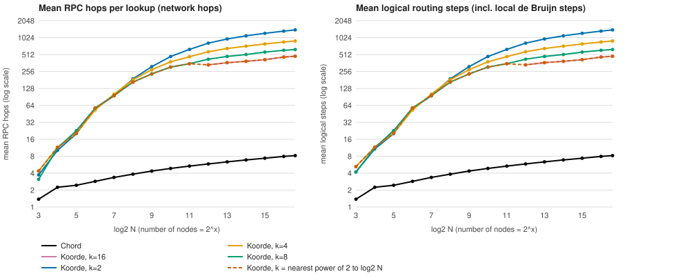
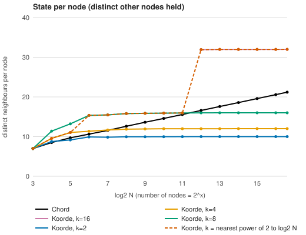

# Hop-count study: Chord and Koorde from 8 to 100,000 nodes

Back to the [project README](../README.md). This study counts lookup hops in a simulation, because the experiments in the [benchmark report](benchmark-report.md) stopped at 32 nodes. It reports measured numbers only. Everything it says about causes is labelled as such.

## Summary of what was measured

- Chord: the mean number of RPC hops grows from 2.43 at N=32 to 8.19 at N=100,000, about half of log2 N, with a p99 of 13 at N=100,000.
- Koorde, with the routing tables a stabilised node builds in this repository, needs more RPC hops than Chord at every size tested, from N=8 (3.1 to 4.4 against 1.38) up to N=100,000. The mean is 20.1 (k=2), 20.5 (k=4) and 22.7 (k=8) at N=32, against 2.43 for Chord. At N=100,000 it is 1,406 (k=2), 893 (k=4), 630 (k=8) and 478 (k=16, the power of two nearest log2 N), against 8.19 for Chord.
- Koorde's mean grows with N over the whole range, and faster than log N in the data (for k=2 it rises from 20 at N=32 to 1,406 at N=100,000, while log2 N rises from 5 to 16.6). Raising k lowers it, but at N=100,000 even k=16 is about 58 times Chord's mean.
- Koorde keeps fewer table slots than Chord: 10 to 32 (de Bruijn window plus successor list) against 74 (66 fingers plus 8 successors). Counted as distinct other nodes the gap is smaller, because many Chord fingers point to the same node: at N=100,000 Chord holds 21.2 distinct neighbours and Koorde holds 10.0 (k=2), 12.0 (k=4), 16.0 (k=8) and 32.0 (k=16).
- Measured inside the simulation, successor steps (walking the ring) are 79% to 97% of Koorde's steps for N from 32 up, and about half of all lookups start from the fallback start node (see "Where the hops go").

These results come from a model of a stabilised ring (see "What the model leaves out"). They were not checked against a real cluster larger than the 8-node in-process test, so they are a prediction about the code's routing decisions, not a measurement of a deployment.

## Method

### What is simulated

`cmd/hopsim` builds a ring of N nodes with uniform random IDs and gives every node the routing state a converged node would hold. It then runs 10,000 random (entry node, key) lookups per point and counts hops. The routing decisions are not re-implemented. The simulator calls the same pure functions as the nodes:

| Protocol | Functions shared by the node code and the simulator |
|---|---|
| Koorde | `logicnode.InitStep` (start of a lookup, via `Space.BestImaginary`), `logicnode.DecideStep` (one step: return, de Bruijn hop, or successor hop), the unexported `findNextHop` it uses, `logicnode.EstimateSizeFromGap`, `Space.ComputeFaultTolerantTarget` |
| Chord | `chord.NextHop`, `chord.ClosestPreceding` |

Before this study these decisions were inline in `FindSuccessorStep`, `FindSuccessorInit`, `Chord.LookUp` and `ClosestPrecedingNode`. They were moved into the pure functions above without changing behaviour; the node methods now call them. The earlier gRPC hop tests (`internal/node/server/hops_test.go`) pass unchanged.

### Two numbers per lookup

- **RPC hops**: node-to-node `FindSuccessor` calls. This is what `lookuptrace.Counter` counts in a running node and what costs network latency.
- **Logical steps**: every forwarding decision, including Koorde's de Bruijn steps in which a node's de Bruijn pointer is the node itself (no RPC). This is what the Koorde paper's analysis counts. For Chord the two are equal.

Over all rows the largest difference between the two means is 1.09 (Koorde k=8 at N=8). From N=32 on the two means differ by at most 0.3 in every main-run row, so the two charts look alike; local steps matter only in very small rings.

### Parameters

| Parameter | Value | Source |
|---|---|---|
| ID bits | 66 | `idBits: 66` in `config/local-cluster/*.yaml`, `config/chord-test/*.yaml` and every other node config in the repository except one that uses 64 |
| Successor list size | 8 | `successorListSize: 8` in the same configs |
| Koorde degrees | 2, 4, 8, and the power of two nearest log2 N in log scale | The configs use 2 and 8 |
| Node IDs, entries, keys | uniform random, `math/rand`, seed 1 | the ring and the (entry, key) pairs depend only on (seed, N), so all protocols at one N see the same ring and the same lookups |
| Lookups per point | 10,000 | |
| Chord fingers | `finger[i] = successor(id + 2^i)`, i = 0..65 | as `fixFinger` in `chord/stabilization.go` converges to |
| Koorde window (main runs, "realistic") | as `fixDeBruijn` in `logicnode/worker.go` builds it, see below | |

Koorde window as `fixDeBruijn` builds it: the node estimates N from the gap to its first successor (`EstimateSizeFromGap`, a single gap, so the estimate is noisy); it computes `target = k*m - x` with `ComputeFaultTolerantTarget`; the anchor is the predecessor of `successor(target)`; window entry 0 is the anchor and entry i is the i-th successor of the anchor; only k entries are kept (`SetDeBruijnList` truncates to the degree).

State per node is counted for the first 2,000 nodes by index (all nodes when N is smaller; node IDs are random, so this is a uniform sample). "Slots" is table entries (66 fingers + 8 successors for Chord; k window entries + successors for Koorde). "Distinct" is the number of different other nodes among them.

Degree 16 is outside the repository's configuration rules (`degree` must be at most `successorListSize`, and `idBits` must be a multiple of log2 of the degree, which 66 is not for 16). The k=16 rows therefore use 64 ID bits and a successor list of 16, recorded in the `id_bits` and `succ_list_size` columns of the CSV. The "k nearest log2 N" rows use k=16 from N=4,096 up; below that they repeat the k=4 or k=8 run.

### Validation before any large run

`cmd/hopsim/sim_test.go` first reproduces, exactly, the counts of the gRPC tests on the same 8-node, 8-bit ring (IDs 0, 32, ..., 224) with the textbook routing tables: Chord 0, 1, 1, 2, 3, 2 hops; Koorde k=2 0, 3, 1; Koorde k=4 0, 2. It also checks the logical-step counts (k=2: 0, 4, 4; the difference from the RPC counts is the local de Bruijn steps), derives one realistic window by hand (node 0, k=2: window [96, 128]), and checks on random rings of 500 and 1,000 nodes, for all three window modes and k = 2, 4, 8 and 16, that every lookup ends at the true successor of the key. In the full sweep, all 109 rows have zero unfinished lookups and zero wrong owners.

## Results

Realistic tables (the main runs), 10,000 lookups per row, seed 1, 66 ID bits (64 for k=16).





| N | protocol | RPC hops: mean | median | p99 | max | logical steps: mean | median | p99 | max | state: distinct neighbours | slots |
|---|---|---|---|---|---|---|---|---|---|---|---|
| 8 | Chord | 1.38 | 1 | 3 | 4 | 1.38 | 1 | 3 | 4 | 7.0 | 74 |
| 8 | Koorde k=2 | 3.73 | 3 | 10 | 17 | 4.20 | 4 | 16 | 26 | 7.0 | 10 |
| 8 | Koorde k=4 | 4.36 | 3 | 23 | 74 | 5.22 | 4 | 26 | 78 | 7.0 | 12 |
| 8 | Koorde k=8 | 3.10 | 2 | 16 | 21 | 4.19 | 2 | 22 | 22 | 7.0 | 16 |
| 8 | Koorde k≈log2 N (k=4) | 4.36 | 3 | 23 | 74 | 5.22 | 4 | 26 | 78 | 7.0 | 12 |
| 32 | Chord | 2.43 | 2 | 5 | 6 | 2.43 | 2 | 5 | 6 | 9.7 | 74 |
| 32 | Koorde k=2 | 20.14 | 17 | 68 | 109 | 20.14 | 17 | 68 | 109 | 9.2 | 10 |
| 32 | Koorde k=4 | 20.50 | 14 | 98 | 224 | 20.57 | 14 | 98 | 226 | 11.0 | 12 |
| 32 | Koorde k=8 | 22.69 | 15 | 122 | 180 | 22.84 | 15 | 124 | 180 | 13.2 | 16 |
| 32 | Koorde k≈log2 N (k=4) | 20.50 | 14 | 98 | 224 | 20.57 | 14 | 98 | 226 | 11.0 | 12 |
| 64 | Chord | 2.86 | 3 | 5 | 6 | 2.86 | 3 | 5 | 6 | 10.6 | 74 |
| 64 | Koorde k=2 | 56.62 | 43 | 314 | 542 | 56.77 | 43 | 314 | 542 | 9.9 | 10 |
| 64 | Koorde k=4 | 52.98 | 35 | 354 | 528 | 53.05 | 35 | 354 | 528 | 11.3 | 12 |
| 64 | Koorde k=8 | 57.57 | 38 | 271 | 350 | 57.59 | 38 | 271 | 350 | 15.3 | 16 |
| 64 | Koorde k≈log2 N (k=8) | 57.57 | 38 | 271 | 350 | 57.59 | 38 | 271 | 350 | 15.3 | 16 |
| 256 | Chord | 3.83 | 4 | 7 | 8 | 3.83 | 4 | 7 | 8 | 12.6 | 74 |
| 256 | Koorde k=2 | 189.47 | 131 | 1077 | 1307 | 189.52 | 131 | 1077 | 1307 | 10.0 | 10 |
| 256 | Koorde k=4 | 182.79 | 105 | 623 | 802 | 182.79 | 105 | 623 | 802 | 11.9 | 12 |
| 256 | Koorde k=8 | 165.73 | 132 | 484 | 580 | 165.73 | 132 | 484 | 580 | 15.8 | 16 |
| 256 | Koorde k≈log2 N (k=8) | 165.73 | 132 | 484 | 580 | 165.73 | 132 | 484 | 580 | 15.8 | 16 |
| 1024 | Chord | 4.85 | 5 | 8 | 10 | 4.85 | 5 | 8 | 10 | 14.6 | 74 |
| 1024 | Koorde k=2 | 473.30 | 258 | 1468 | 1738 | 473.33 | 258 | 1468 | 1738 | 10.0 | 10 |
| 1024 | Koorde k=4 | 380.96 | 393 | 812 | 973 | 380.98 | 393 | 812 | 973 | 12.0 | 12 |
| 1024 | Koorde k=8 | 306.60 | 360 | 606 | 764 | 306.60 | 360 | 606 | 764 | 15.9 | 16 |
| 1024 | Koorde k≈log2 N (k=8) | 306.60 | 360 | 606 | 764 | 306.60 | 360 | 606 | 764 | 15.9 | 16 |
| 4096 | Chord | 5.83 | 6 | 10 | 11 | 5.83 | 6 | 10 | 11 | 16.6 | 74 |
| 4096 | Koorde k=2 | 817.79 | 417 | 1838 | 2059 | 817.80 | 417 | 1838 | 2059 | 10.0 | 10 |
| 4096 | Koorde k=4 | 573.94 | 710 | 1010 | 1248 | 573.94 | 710 | 1010 | 1248 | 12.0 | 12 |
| 4096 | Koorde k=8 | 423.41 | 477 | 745 | 918 | 423.43 | 477 | 745 | 918 | 16.0 | 16 |
| 4096 | Koorde k≈log2 N (k=16) | 335.95 | 349 | 653 | 922 | 335.95 | 349 | 653 | 922 | 31.9 | 32 |
| 16384 | Chord | 6.87 | 7 | 11 | 14 | 6.87 | 7 | 11 | 14 | 18.6 | 74 |
| 16384 | Koorde k=2 | 1102.52 | 616 | 2168 | 2437 | 1102.52 | 616 | 2168 | 2437 | 10.0 | 10 |
| 16384 | Koorde k=4 | 722.98 | 854 | 1175 | 1341 | 722.98 | 854 | 1175 | 1341 | 12.0 | 12 |
| 16384 | Koorde k=8 | 512.75 | 568 | 861 | 1067 | 512.75 | 568 | 861 | 1067 | 16.0 | 16 |
| 16384 | Koorde k≈log2 N (k=16) | 387.64 | 406 | 712 | 978 | 387.64 | 406 | 712 | 978 | 32.0 | 32 |
| 65536 | Chord | 7.92 | 8 | 12 | 15 | 7.92 | 8 | 12 | 15 | 20.6 | 74 |
| 65536 | Koorde k=2 | 1335.69 | 853 | 2467 | 2796 | 1335.69 | 853 | 2467 | 2796 | 10.0 | 10 |
| 65536 | Koorde k=4 | 856.37 | 993 | 1347 | 1542 | 856.37 | 993 | 1347 | 1542 | 12.0 | 12 |
| 65536 | Koorde k=8 | 610.67 | 663 | 992 | 1244 | 610.67 | 663 | 992 | 1244 | 16.0 | 16 |
| 65536 | Koorde k≈log2 N (k=16) | 462.74 | 477 | 825 | 1065 | 462.74 | 477 | 825 | 1065 | 32.0 | 32 |
| 100000 | Chord | 8.19 | 8 | 13 | 15 | 8.19 | 8 | 13 | 15 | 21.2 | 74 |
| 100000 | Koorde k=2 | 1405.99 | 1164 | 2587 | 2849 | 1405.99 | 1164 | 2587 | 2849 | 10.0 | 10 |
| 100000 | Koorde k=4 | 892.53 | 1028 | 1402 | 1697 | 892.53 | 1028 | 1402 | 1697 | 12.0 | 12 |
| 100000 | Koorde k=8 | 629.57 | 682 | 1024 | 1190 | 629.57 | 682 | 1024 | 1190 | 16.0 | 16 |
| 100000 | Koorde k≈log2 N (k=16) | 477.95 | 492 | 837 | 1116 | 477.95 | 492 | 837 | 1116 | 32.0 | 32 |

The full data for all N from 8 to 100,000 is in [`results/hopsim/results.csv`](../results/hopsim/results.csv).

## Where the hops go

Three further runs on the same rings change only how the Koorde window is built, and the simulator also records, per lookup, how many steps were successor steps and whether the start fell back to `BestImaginarySimple`. This table shows N = 1,024, 16,384 and 65,536.

- `textbook`: window = predecessor(k*m) and its k-1 successors.
- `trueN`: the `fixDeBruijn` anchor rule with the true N in place of the one-gap estimate.
- `realistic`: as above (the main runs).
- "Fallback start": `BestImaginary` could not place the start node strictly inside (self, successor), so it used `BestImaginarySimple` (start at self+1, with all ID bits still to shift in).

| N | protocol | window | RPC hops mean | median | p99 | successor steps per lookup | lookups whose start fell back | RPC hops mean, fallback starts | RPC hops mean, normal starts |
|---|---|---|---|---|---|---|---|---|---|
| 1024 | Koorde k=2 | textbook | 82.5 | 40 | 183 | 46.5 | 49.8% | 138.5 | 26.9 |
| 1024 | Koorde k=2 | trueN | 358.0 | 177 | 903 | 330.1 | 49.8% | 572.0 | 145.5 |
| 1024 | Koorde k=2 | realistic | 473.3 | 258 | 1468 | 449.1 | 49.8% | 737.0 | 211.5 |
| 1024 | Koorde k=4 | textbook | 70.9 | 82 | 138 | 46.1 | 49.8% | 89.5 | 52.4 |
| 1024 | Koorde k=4 | trueN | 276.7 | 374 | 482 | 254.9 | 49.8% | 347.2 | 206.7 |
| 1024 | Koorde k=4 | realistic | 381.0 | 393 | 812 | 361.2 | 49.8% | 472.2 | 290.4 |
| 1024 | Koorde k=8 | textbook | 77.0 | 80 | 171 | 58.9 | 49.8% | 90.2 | 64.0 |
| 1024 | Koorde k=8 | trueN | 210.6 | 251 | 365 | 193.8 | 49.8% | 244.5 | 176.9 |
| 1024 | Koorde k=8 | realistic | 306.6 | 360 | 606 | 290.8 | 49.8% | 356.3 | 257.2 |
| 1024 | Koorde k≈log2 N (k=8) | textbook | 77.0 | 80 | 171 | 58.9 | 49.8% | 90.2 | 64.0 |
| 1024 | Koorde k≈log2 N (k=8) | trueN | 210.6 | 251 | 365 | 193.8 | 49.8% | 244.5 | 176.9 |
| 1024 | Koorde k≈log2 N (k=8) | realistic | 306.6 | 360 | 606 | 290.8 | 49.8% | 356.3 | 257.2 |
| 16384 | Koorde k=2 | textbook | 94.6 | 68 | 185 | 53.6 | 50.2% | 152.2 | 36.7 |
| 16384 | Koorde k=2 | trueN | 678.6 | 362 | 1191 | 638.6 | 50.2% | 1079.9 | 274.6 |
| 16384 | Koorde k=2 | realistic | 1102.5 | 616 | 2168 | 1063.1 | 50.2% | 1757.4 | 443.2 |
| 16384 | Koorde k=4 | textbook | 78.8 | 88 | 143 | 52.1 | 50.2% | 97.5 | 60.1 |
| 16384 | Koorde k=4 | trueN | 444.7 | 541 | 624 | 418.2 | 50.2% | 546.2 | 342.4 |
| 16384 | Koorde k=4 | realistic | 723.0 | 854 | 1175 | 696.8 | 50.2% | 890.7 | 554.1 |
| 16384 | Koorde k=8 | textbook | 81.7 | 84 | 178 | 62.8 | 50.2% | 95.1 | 68.2 |
| 16384 | Koorde k=8 | trueN | 312.1 | 352 | 463 | 293.3 | 50.2% | 361.1 | 262.7 |
| 16384 | Koorde k=8 | realistic | 512.8 | 568 | 861 | 494.1 | 50.2% | 596.0 | 429.0 |
| 16384 | Koorde k≈log2 N (k=16) | textbook | 97.4 | 94 | 240 | 83.0 | 49.8% | 108.8 | 86.0 |
| 16384 | Koorde k≈log2 N (k=16) | trueN | 229.9 | 242 | 411 | 215.6 | 49.8% | 255.9 | 204.2 |
| 16384 | Koorde k≈log2 N (k=16) | realistic | 387.6 | 406 | 712 | 373.4 | 49.8% | 430.6 | 345.0 |
| 65536 | Koorde k=2 | textbook | 97.4 | 117 | 186 | 55.2 | 50.3% | 152.6 | 41.7 |
| 65536 | Koorde k=2 | trueN | 795.1 | 502 | 1322 | 753.2 | 50.3% | 1239.7 | 345.7 |
| 65536 | Koorde k=2 | realistic | 1335.7 | 853 | 2467 | 1294.0 | 50.3% | 2089.1 | 574.1 |
| 65536 | Koorde k=4 | textbook | 80.9 | 89 | 147 | 53.8 | 50.3% | 99.1 | 62.6 |
| 65536 | Koorde k=4 | trueN | 509.3 | 609 | 694 | 482.3 | 50.3% | 619.9 | 397.5 |
| 65536 | Koorde k=4 | realistic | 856.4 | 993 | 1347 | 829.4 | 50.3% | 1046.5 | 664.2 |
| 65536 | Koorde k=8 | textbook | 84.3 | 86 | 174 | 64.9 | 50.3% | 96.1 | 72.3 |
| 65536 | Koorde k=8 | trueN | 360.8 | 399 | 506 | 341.4 | 50.3% | 409.9 | 311.1 |
| 65536 | Koorde k=8 | realistic | 610.7 | 663 | 992 | 591.3 | 50.3% | 695.9 | 524.5 |
| 65536 | Koorde k≈log2 N (k=16) | textbook | 104.0 | 100 | 256 | 89.3 | 48.8% | 114.3 | 94.3 |
| 65536 | Koorde k≈log2 N (k=16) | trueN | 266.6 | 277 | 461 | 252.0 | 48.8% | 291.2 | 243.2 |
| 65536 | Koorde k≈log2 N (k=16) | realistic | 462.7 | 477 | 825 | 448.1 | 48.8% | 506.6 | 421.0 |

What the numbers show:

- About half of all lookups (48.8% to 50.3% in the rows of this table) start from the fallback start node, and their mean hop count is higher than for the other lookups in every row.
- Successor steps are almost all of the steps. In the realistic rows at N=65,536 they are 1,294 of 1,336 steps (k=2) and 448 of 463 (k=16).
- The three window rules rank the same way for every k and N in the table: textbook is the lowest, then trueN, then realistic. At N=65,536 with k=2 the mean is 97.4, 795.1 and 1,335.7 hops. At N=65,536 the textbook rows stay between 80.9 and 104.0 hops for all four k.

What the numbers are consistent with, not something this study tested directly: with the window entries starting at the predecessor of `k*m - x`, where x spans about log N nodes, the node that a de Bruijn step needs often lies beyond the k window entries, so the step lands short and the lookup walks the ring to reach it. That is what a large successor-step count would look like. A different explanation was not excluded: no experiment here changed only that one thing.

## Comparison with the benchmark report

The benchmark report ([`benchmark-report.md`](benchmark-report.md)) measured latency on AWS EKS with 8 to 32 nodes. The simulation gives hop counts, not latency, so only the direction of the claims can be compared.

- "Koorde showed a clear increase in latency as nodes were added (25ms to 55ms)" and "tail latency (P95/P99) for Koorde is significantly higher than Chord": the simulation points the same way. Between N=8 and N=32 the mean RPC hops of Koorde k=2 go from 3.7 to 20.1, the p99 is 68 at N=32, and Chord's mean and p99 are 2.4 and 5. The simulation says nothing about why the measured latencies differ by a factor of about 3 where the hop counts differ by a factor of about 8.
- "At 32 nodes, Koorde with k=8 (50.3 ms) was faster than k=2 (54.9 ms)": the simulation does not reproduce this at N=32. There the mean RPC hops are 22.7 (k=8) and 20.1 (k=2). k=8 has the lower mean from N=256 up (for example 306.6 against 473.3 at N=1,024); at N=64 and N=128 the two are within 1 hop of each other (56.6 and 57.6; 94.7 and 95.7), with k=2 slightly lower. So the simulation supports the claim at larger sizes but not at the sizes the report measured.
- "Koorde's benefits might only become apparent at much larger scales (e.g., thousands of nodes)" and the expected crossover: in this simulation no crossover appears up to N=100,000. Koorde's mean RPC hop count stays above Chord's at every N from 8 to 100,000, for every k, and the gap widens rather than closing. This is a statement about the code's routing decisions as simulated. It does not say what Koorde with a different window or a different start rule would do, and it does not say anything about latency, where per-hop cost matters.
- "Chord's simpler logic and efficient pointer chasing proved superior": consistent with the hop counts. The simulation does not measure per-hop cost.
- The report's Koorde asymptotic bound O(log N / log log N) is a property of the algorithm in the paper. The simulation measures this repository's implementation, and its means do not follow that shape over the range tested.

## What the model leaves out

- No failures, no churn, no node joins or leaves. Every node is alive and every table is complete and consistent.
- Rings are stabilised by construction. Tables are computed from the full membership, not by running the stabilisation protocol. The real `fixFinger` and `fixDeBruijn` need time to converge and can be stale.
- No latency, no queueing, no message cost. Hops are counted, not timed.
- The `fixDeBruijn` anchor is computed as the exact predecessor of the successor of the target. A real node finds it with a lookup that has the same routing behaviour.
- When a call fails, the real code tries the next window entry. With no failures the first candidate is always taken, which is what the simulator does.
- The N estimate is the repository's one-gap estimate, taken from the first successor only. It is capped at 1,000,000 as in the code.
- Random IDs only. No clustered or adversarial IDs, and no hashing of keys: keys are random IDs.
- One seed. The study did not repeat the runs over other seeds, so there is no spread between seeds to report, only the spread between lookups within one ring.
- Validation against a real cluster exists only for the 8-node ring, in the in-process gRPC tests.

## Reproduce

```
go test ./cmd/hopsim            # validation gate
go run ./cmd/hopsim -out results/hopsim
```

The sweep (109 rows: all sizes from 8 to 100,000, the main runs plus the sensitivity runs) took 8.8 seconds of wall time with 12 workers on the development machine. The numbers were produced by the code in the commit that adds this study; rerun with the command above.

Files: `cmd/hopsim/{main,sim,svg}.go` and `sim_test.go`; `internal/node/logicnode/step.go`; `results/hopsim/results.csv`, `hops.svg`, `state.svg`.
